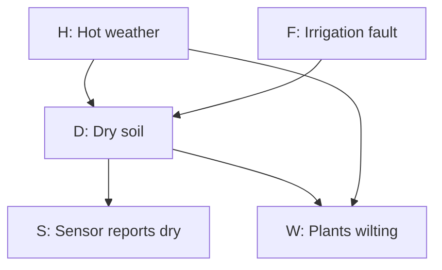
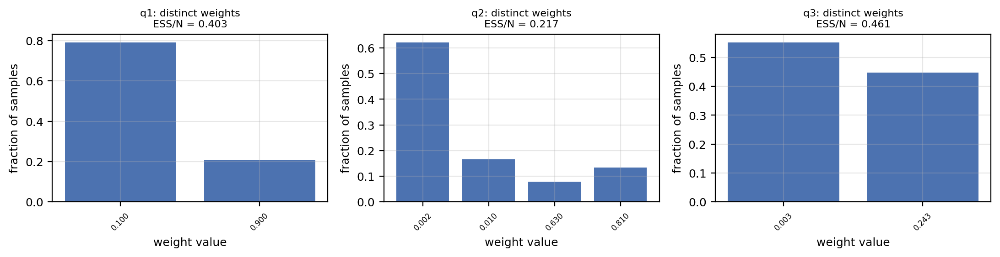
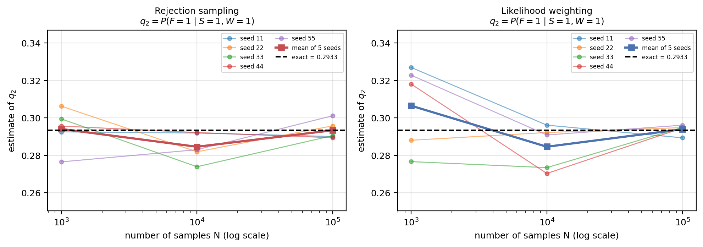
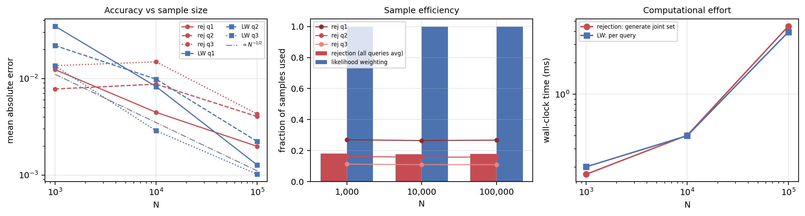

# Part A: Bayesian Networks — A Step-by-Step Beginner's Guide

This guide explains `PartA_Bayesian Network.ipynb` in simple English. You do not need to know Bayesian networks before you start.

We will first understand the story, then calculate the answers by hand, and then connect those calculations to the Python code.

The probabilities come from the notebook's teaching example. They are assumed values, not measurements from a real greenhouse. Small sample tables labelled **practice example** are made up to explain a method; they are not saved notebook results.

**Suggested reading pace:** Read Sections 1–5 first. Then work through one calculation at a time in Sections 6–8. Read the sampling sections only after the exact calculations make sense. You can use the code map near the end while looking at the notebook.

## 1. What problem are we trying to solve?

Imagine that you look after a greenhouse.

The soil sensor says, “The soil is dry.” You also see that the plants are wilting.

You want to know:

> How likely is it that the irrigation system has a fault?

There is a problem: a fault is not the only possible explanation. Hot weather can also make the soil dry and the plants wilt. The sensor can also make mistakes.

So we cannot simply say:

> The sensor says dry, so the irrigation must be broken.

Instead, we calculate how likely a fault is after taking the observations into account.

The notebook does this in four parts:

| Notebook part | Plain-English purpose |
|---|---|
| A1: Represent and check the model | Describe the relationships and calculate exact answers. |
| A2: Forward and rejection sampling | Generate pretend greenhouse situations, keep the relevant ones, and count faults. |
| A3: Likelihood weighting | Generate situations while fixing the observations, then give each situation a suitable weight. |
| A4: Compare and interpret | Check how close the estimates are to the exact answers and explain the results. |

There is no model training here. The probability tables are already supplied. The task is to use them to answer questions.

## 2. The five letters and the basic symbols

Each variable has only two possible values: `1` means yes, and `0` means no. This is called a **binary variable**.

| Letter | Meaning | Value 1 | Value 0 |
|---|---|---|---|
| `H` | Hot weather | It is hot. | It is not hot. |
| `F` | Irrigation fault | There is a fault. | There is no fault. |
| `D` | Dry soil | The soil is dry. | The soil is not dry. |
| `S` | Sensor report | The sensor reports dry. | The sensor does not report dry. |
| `W` | Wilting plants | The plants are wilting. | The plants are not wilting. |

**Keep `D` and `S` separate.** `D` is the actual soil condition. `S` is what the sensor reports. They can disagree.

### 2.1 What does `P` mean?

`P` means probability, or chance.

```text
P(F=1) = 0.08
```

Read this as:

> The chance of an irrigation fault is 0.08, which is 8%.

To turn a decimal probability into a percentage, multiply by 100:

```text
0.08 × 100 = 8%
0.30 × 100 = 30%
0.90 × 100 = 90%
```

A probability of `0` means impossible in this model. A probability of `1` means certain in this model.

### 2.2 What does the vertical line mean?

The symbol `|` means **given that we know**.

```text
P(F=1 | S=1)
```

Read this as:

> The chance of a fault, given that the sensor reports dry.

The information after `|` is called the **evidence**.

### 2.3 What does a comma mean?

A comma joins conditions with “and.”

```text
P(F=1, S=1)
```

means:

> The chance that there is a fault AND the sensor reports dry.

These two questions are different:

| Expression | Which situations are we considering? |
|---|---|
| `P(F=1, S=1)` | All situations; ask how often both things happen. |
| `P(F=1 \| S=1)` | Only situations with a dry report; ask how often there is a fault within that group. |

### 2.4 Prior and posterior

The **prior** is the probability before using the observations. Here, the prior fault probability is 8%.

The **posterior** is the probability after using the observations. For example, after seeing a dry report, the fault probability becomes about 23.15%.

The model's starting value `P(F=1)=0.08` is still the same. We are now asking about a more specific group: situations with the observed evidence.

## 3. What is the Bayesian network?

A Bayesian network is a diagram of variables together with probability tables. The arrows tell us which values a variable's probability depends on directly in the model.



If your Markdown viewer does not draw the diagram, the five arrows are:

```text
H → D     Hot weather affects the chance of dry soil.
F → D     An irrigation fault affects the chance of dry soil.
D → S     Actual soil dryness affects the sensor report.
D → W     Dry soil affects the chance of wilting.
H → W     Hot weather also directly affects the chance of wilting.
```

An arrow does not mean that the outcome always happens. Hot weather raises certain probabilities; it does not make every plant wilt.

### 3.1 Parents and roots

A **parent** is a variable with an arrow pointing directly into another variable.

| Variable | Parents | Information needed to choose its probability |
|---|---|---|
| `H` | None | Use its starting probability. |
| `F` | None | Use its starting probability. |
| `D` | `H`, `F` | Is it hot? Is there a fault? |
| `S` | `D` | Is the soil actually dry? |
| `W` | `H`, `D` | Is it hot? Is the soil dry? |

`H` and `F` are **roots**, because they have no parents. The model assumes they are independent before we observe evidence. Knowing it is hot, by itself, does not change the starting 8% fault probability.

A valid calculation order is:

```text
H, F, D, S, W
```

This is called a **topological order**. It simply means that parents come before their children. For example, calculate `H` and `F` before selecting the probability for `D`.

### 3.2 Conditional independence, in simple words

The notebook writes:

```text
S is independent of W, given D and H.
```

This means:

> If we already know the soil condition and the weather, learning whether the plants are wilting does not change the sensor probability in this model.

For example, after fixing `D=1` and `H=0`, the chance of `S=1` is 0.90 whether `W` is 0 or 1.

This lets us multiply the sensor and wilting probabilities **when `D` and `H` are fixed**. We use that rule in the second hand calculation.

It does not mean the sensor and wilting are unrelated in general. Without knowing the soil condition, a dry sensor report gives us information about dry soil, which also tells us something about wilting.

## 4. Read the probability tables slowly

A **conditional probability table**, or **CPT**, is a lookup table. Choose the row that matches the parent values, then read the probability.

### 4.1 Starting probabilities

| Event | Probability | Meaning |
|---|---:|---|
| `H=1` | 0.30 | Hot weather has a 30% chance. |
| `H=0` | 0.70 | Not-hot weather has a 70% chance. |
| `F=1` | 0.08 | A fault has an 8% chance. |
| `F=0` | 0.92 | No fault has a 92% chance. |

For any binary variable, the probabilities of 0 and 1 add up to 1:

```text
P(F=0) = 1 − P(F=1)
       = 1 − 0.08
       = 0.92
```

### 4.2 Probability of dry soil

| `H` | `F` | Situation | `P(D=1 \| H,F)` | `P(D=0 \| H,F)` |
|---:|---:|---|---:|---:|
| 0 | 0 | Not hot, no fault | 0.05 | 0.95 |
| 0 | 1 | Not hot, fault | 0.80 | 0.20 |
| 1 | 0 | Hot, no fault | 0.40 | 0.60 |
| 1 | 1 | Hot, fault | 0.95 | 0.05 |

For example, when it is hot and there is no fault, dry soil still has a 40% chance. This is why a dry report does not automatically prove a fault.

The code stores the probability-of-1 column as:

```python
P_D1_given_HF = np.array([
    [0.05, 0.80],   # H=0; columns F=0, F=1
    [0.40, 0.95],   # H=1; columns F=0, F=1
])
```

Python starts counting positions at 0. The first index chooses `H`; the second chooses `F`:

```python
P_D1_given_HF[1][0]  # Hot, no fault → 0.40
P_D1_given_HF[0][1]  # Not hot, fault → 0.80
```

The order matters. Reversing the indices changes the meaning.

### 4.3 Probability that the sensor reports dry

| Actual soil condition | `P(S=1 \| D)` | `P(S=0 \| D)` |
|---|---:|---:|
| `D=0`: soil is not dry | 0.10 | 0.90 |
| `D=1`: soil is dry | 0.90 | 0.10 |

The sensor can make two kinds of mistakes:

- It can report dry when the soil is not dry: a false alarm.
- It can fail to report dry when the soil is dry: a missed detection.

**Be careful with the direction.** `P(S=1 | D=1)=0.90` does not mean `P(D=1 | S=1)=0.90`. One starts with known dry soil; the other starts with a sensor report. They describe different groups.

### 4.4 Probability of wilting

| `H` | `D` | Situation | `P(W=1 \| H,D)` | `P(W=0 \| H,D)` |
|---:|---:|---|---:|---:|
| 0 | 0 | Not hot, soil not dry | 0.02 | 0.98 |
| 0 | 1 | Not hot, dry soil | 0.70 | 0.30 |
| 1 | 0 | Hot, soil not dry | 0.10 | 0.90 |
| 1 | 1 | Hot, dry soil | 0.90 | 0.10 |

Notice that hot weather can cause wilting even when the soil is not dry. That is why the graph includes the direct arrow `H → W`.

## 5. A1: Calculate one complete situation

A **state** is one complete set of values for all five variables.

For example:

```text
H=1, F=1, D=1, S=1, W=1
```

This means it is hot, there is a fault, the soil is dry, the sensor reports dry, and the plants are wilting.

The network gives us this multiplication rule:

```text
P(H,F,D,S,W)
    = P(H) × P(F) × P(D | H,F) × P(S | D) × P(W | H,D)
```

This is the **joint probability**: the chance of all five values happening together.

For the all-ones state:

```text
P(H=1,F=1,D=1,S=1,W=1)
    = 0.30 × 0.08 × 0.95 × 0.90 × 0.90

    0.30 × 0.08 = 0.024
    0.024 × 0.95 = 0.0228
    0.0228 × 0.90 = 0.02052
    0.02052 × 0.90 = 0.018468

Answer = 0.018468 = 1.8468%
```

This is not yet the answer to a fault-diagnosis question. It is the probability of one complete situation.

### 5.1 Why are there 32 states?

There are five variables, each with two possibilities:

```text
2 × 2 × 2 × 2 × 2 = 32
```

The notebook calculates the probability of every state. This is called **enumeration**, which means listing all possibilities.

The 32 probabilities must add up to 1 because one of those complete situations must occur. The notebook checks that they do, and that no probability is negative.

The graph needs only 12 supplied probabilities of a value being 1: `1 + 1 + 4 + 2 + 4`. All the probability-of-0 values follow from `1 − p`. A completely unrestricted 32-state table would need 31 independently chosen probabilities, with the last one fixed by the total of 1.

### 5.2 What do `bern` and `joint_probability` do?

```python
def bern(p, value):
    return p if value == 1 else 1.0 - p
```

`bern` chooses the probability for the requested value:

```text
bern(0.30, 1) returns 0.30.
bern(0.30, 0) returns 0.70.
```

The function `joint_probability(...)` calls this helper five times and multiplies the results, just like our hand calculation.

### 5.3 Why check more than the total?

A table can add up to 1 and still describe the wrong model.

The notebook deliberately swaps the `H` and `F` indices for dry soil. The total still equals 1, but the first diagnostic answer changes from about 0.23150 to 0.13043.

So it also checks starting probabilities, independence relationships, and diagnostic results. The deliberately wrong lookup is a demonstration, not the function used for the main experiments.

## 6. Hand calculation for q1: the sensor reports dry

The first question is:

```text
q1 = P(F=1 | S=1)
```

In words:

> Among situations where the sensor reports dry, what fraction have a fault?

The basic rule is:

```text
P(F=1 | S=1) = P(F=1, S=1) / P(S=1)
```

The top of a fraction is its **numerator**. The bottom is its **denominator**. Here, we divide “fault and dry report” by “all dry reports.”

### Step 1: How likely is dry soil if there is a fault?

We have not observed the weather, so we must include both weather possibilities. “Not observed” does not mean `H=0`.

```text
P(D=1 | F=1)
    = P(H=0) × P(D=1 | H=0,F=1)
      + P(H=1) × P(D=1 | H=1,F=1)

    = 0.70 × 0.80 + 0.30 × 0.95
    = 0.56 + 0.285
    = 0.845
```

We multiply along each possibility, then add the two alternatives. They cover all weather possibilities and cannot happen at the same time.

So, with a fault, the soil is dry with probability 0.845 and not dry with probability:

```text
1 − 0.845 = 0.155
```

### Step 2: How likely is a dry sensor report if there is a fault?

A dry report can happen in two ways:

1. The soil is dry and the sensor reports it correctly.
2. The soil is not dry and the sensor gives a false alarm.

```text
P(S=1 | F=1)
    = 0.845 × 0.90 + 0.155 × 0.10
    = 0.7605 + 0.0155
    = 0.776
```

### Step 3: Repeat for no fault

First calculate actual dryness:

```text
P(D=1 | F=0)
    = 0.70 × 0.05 + 0.30 × 0.40
    = 0.035 + 0.12
    = 0.155
```

Then calculate the sensor report:

```text
P(S=1 | F=0)
    = 0.155 × 0.90 + 0.845 × 0.10
    = 0.1395 + 0.0845
    = 0.224
```

The two appearances of 0.155 in these steps happen to be equal for the supplied numbers. This is not a general probability rule.

### Step 4: Calculate the two kinds of dry reports

```text
Fault AND dry report:
P(F=1,S=1) = 0.08 × 0.776 = 0.06208

No fault AND dry report:
P(F=0,S=1) = 0.92 × 0.224 = 0.20608
```

Together, they include every dry report:

```text
P(S=1) = 0.06208 + 0.20608 = 0.26816
```

### Step 5: Divide

```text
q1 = 0.06208 / 0.26816
   ≈ 0.23150358
   ≈ 23.15%
```

The dry report raises the fault probability from 8% to about 23.15%. Most dry reports still occur without a fault in this model.

### Optional: picture this as expected counts

Imagine 100,000 situations generated from the model. The expected counts are:

```text
Situations with a fault:      100,000 × 0.08 = 8,000
Situations without a fault:   100,000 × 0.92 = 92,000

Dry reports with a fault:       8,000 × 0.776 = 6,208
Dry reports without a fault:   92,000 × 0.224 = 20,608

All dry reports: 6,208 + 20,608 = 26,816

Fault fraction among dry reports:
6,208 / 26,816 ≈ 23.15%
```

These are expected counts for illustration, not guaranteed counts from a random simulation.

We did not need to include `W` because wilting is not observed in q1. If we included both possibilities for `W`, their conditional probabilities would add to 1.

## 7. Hand calculation for q2: dry report AND wilting

Now the question is:

```text
q2 = P(F=1 | S=1,W=1)
```

In words:

> Among situations where the sensor reports dry and the plants are wilting, what fraction have a fault?

We need:

```text
q2 = P(F=1,S=1,W=1) / P(S=1,W=1)
```

### Step 1: Calculate the chance of both observations for each soil condition

Fix the weather and soil condition first. The model then lets us multiply the probabilities of the sensor report and wilting:

| `H` | `D` | `P(S=1 \| D)` | `P(W=1 \| H,D)` | Chance of both observations |
|---:|---:|---:|---:|---:|
| 0 | 0 | 0.10 | 0.02 | `0.10 × 0.02 = 0.002` |
| 0 | 1 | 0.90 | 0.70 | `0.90 × 0.70 = 0.63` |
| 1 | 0 | 0.10 | 0.10 | `0.10 × 0.10 = 0.01` |
| 1 | 1 | 0.90 | 0.90 | `0.90 × 0.90 = 0.81` |

For example, when it is not hot and the soil is dry, the chance of both observations is 0.63.

### Step 2: Include both possible soil conditions

We do not actually observe `D`, so for each weather-and-fault combination, include dry soil and non-dry soil.

To keep the next table short, call the chance of both observations `L`. It is the **likelihood of the evidence** for that particular `H,F` combination.

```text
L = P(S=1,W=1 | H,F)
```

| `H` | `F` | Calculation: dry contribution + non-dry contribution | `L` |
|---:|---:|---|---:|
| 0 | 0 | `0.05 × 0.63 + 0.95 × 0.002` | 0.0334 |
| 0 | 1 | `0.80 × 0.63 + 0.20 × 0.002` | 0.5044 |
| 1 | 0 | `0.40 × 0.81 + 0.60 × 0.01` | 0.3300 |
| 1 | 1 | `0.95 × 0.81 + 0.05 × 0.01` | 0.7700 |

For example, the last row is:

```text
Hot, fault:
    Probability of dry soil = 0.95
    Probability of non-dry soil = 0.05

L = 0.95 × 0.81 + 0.05 × 0.01
  = 0.7695 + 0.0005
  = 0.7700
```

### Step 3: Include how common each weather-and-fault combination is

Because the roots are independent before evidence, `P(H,F) = P(H) × P(F)`.

| `H` | `F` | Starting chance `P(H,F)` | `L` from Step 2 | Chance of this combination AND both observations |
|---:|---:|---:|---:|---:|
| 0 | 0 | `0.70 × 0.92 = 0.644` | 0.0334 | 0.0215096 |
| 0 | 1 | `0.70 × 0.08 = 0.056` | 0.5044 | 0.0282464 |
| 1 | 0 | `0.30 × 0.92 = 0.276` | 0.3300 | 0.0910800 |
| 1 | 1 | `0.30 × 0.08 = 0.024` | 0.7700 | 0.0184800 |

Each last-column entry is the third column multiplied by the fourth column.

### Step 4: Add all rows for the denominator

Every row has `S=1,W=1`. Add all four rows to get the chance of that evidence:

```text
P(S=1,W=1)
    = 0.0215096 + 0.0282464 + 0.0910800 + 0.0184800
    = 0.159316
```

### Step 5: Add only fault rows for the numerator

The fault rows have `F=1`: the second and fourth rows.

```text
P(F=1,S=1,W=1)
    = 0.0282464 + 0.0184800
    = 0.0467264
```

### Step 6: Divide

```text
q2 = 0.0467264 / 0.159316
   ≈ 0.29329383
   ≈ 29.33%
```

Wilting strengthens the evidence that there is a problem with soil moisture. The fault probability rises from about 23.15% to 29.33%.

## 8. Hand calculation for q3: dry report, wilting, AND hot weather

The third question is:

```text
q3 = P(F=1 | S=1,W=1,H=1)
```

We now know the weather is hot. We can reuse the q2 table and keep only the `H=1` rows.

### Step 1: Find the denominator

```text
P(S=1,W=1,H=1)
    = 0.0910800 + 0.0184800
    = 0.10956
```

### Step 2: Find the numerator

Among those two hot-weather rows, only the last has a fault:

```text
P(F=1,S=1,W=1,H=1) = 0.01848
```

### Step 3: Divide

```text
q3 = 0.01848 / 0.10956
   ≈ 0.16867470
   ≈ 16.87%
```

### Why did the probability go down?

Hot weather offers another explanation for the observations. A fault is now less necessary to explain what we see.

This is called **explaining away**.

It does not rule out a fault. The probability is still about 16.87%, which is above the original 8%.

### The same calculation after fixing `H=1`

Another way to write it is:

```text
Fault and both observations, given hot weather:
    0.08 × 0.77 = 0.0616

No fault and both observations, given hot weather:
    0.92 × 0.33 = 0.3036

q3 = 0.0616 / (0.0616 + 0.3036)
   = 0.0616 / 0.3652
   ≈ 0.16867470
```

Here, `0.3652` is `P(S=1,W=1 | H=1)`. It is not the unconditional probability of all three observations. Multiplying it by `P(H=1)=0.30` gives `0.10956`.

The factor 0.30 cancels when it appears in both numerator and denominator.

## 9. How the exact-inference code matches these calculations

The function is called:

```python
exact_conditional(query_var, query_val, evidence)
```

For q2, the call is:

```python
exact_conditional("F", 1, {"S": 1, "W": 1})
```

It performs four steps:

1. Start with the table of all 32 states.
2. Keep states that match `S=1,W=1` and add their probabilities. This gives the denominator.
3. From those states, keep the ones with `F=1` and add their probabilities. This gives the numerator.
4. Divide the numerator by the denominator.

A **mask** in the code is just a list of yes/no decisions about which rows to keep.

Our hand calculations group states together to save work. The code lists them individually. Both methods add the same probability amounts.

| Query | Numerator | Denominator: `P(evidence)` | Exact result, rounded |
|---|---:|---:|---:|
| q1 | 0.06208 | 0.26816 | 0.23150358 |
| q2 | 0.0467264 | 0.159316 | 0.29329383 |
| q3 | 0.01848 | 0.10956 | 0.16867470 |

These exact values are the reference answers used to judge the sampling methods. “Exact” means exact for the supplied model, apart from computer rounding. It does not mean the model perfectly describes a real greenhouse.

## 10. A2: Forward sampling — make one pretend situation

**Sampling** means drawing a random outcome using the model's probabilities.

For a variable whose chance of being 1 is `p`:

1. Draw a random number `u` between 0 and 1.
2. If `u < p`, set the variable to 1.
3. Otherwise, set it to 0.

For example, if `p=0.30`:

```text
u = 0.12 → 0.12 < 0.30 → output 1
u = 0.82 → 0.82 is not below 0.30 → output 0
```

Uniform random numbers fall below 0.30 about 30% of the time, so this produces the required probability.

### 10.1 A complete practice draw

The following random numbers are chosen for illustration. Follow the order `H,F,D,S,W`:

| Variable | Probability selected | Practice random number | Result |
|---|---:|---:|---|
| `H` | 0.30 | 0.20 | `H=1` because `0.20 < 0.30`. |
| `F` | 0.08 | 0.60 | `F=0` because `0.60 ≥ 0.08`. |
| `D` | 0.40, because `H=1,F=0` | 0.35 | `D=1`. |
| `S` | 0.90, because `D=1` | 0.70 | `S=1`. |
| `W` | 0.90, because `H=1,D=1` | 0.50 | `W=1`. |

The completed sample is:

```text
[H, F, D, S, W] = [1, 0, 1, 1, 1]
```

It is hot, there is no fault, the soil is dry, the sensor reports dry, and the plants are wilting.

This sample matches the evidence for all three questions, but it has no fault. It therefore contributes to their denominators, but not their fault numerators, in rejection sampling.

### 10.2 The two forward-sampling functions

`forward_sample(rng)` generates one complete situation.

`forward_sample_batch(n, rng)` generates `n` situations using arrays. This is called **vectorisation**: Python asks NumPy to work on many values together.

The batch output has `n` rows and five columns:

```text
column:  0  1  2  3  4
meaning: H  F  D  S  W
```

The scalar and batch functions follow the same probability model. They need not produce identical rows with the same seed because they consume random numbers in a different order.

The notebook checks a batch of 400,000 samples against exact single-variable probabilities. For example, the observed fault fraction is about 0.07995, close to the exact 0.08.

## 11. A2: Rejection sampling — keep only matching situations

Forward sampling generates all kinds of situations. A conditional question needs only the situations that match its evidence.

For q2, keep a sample only if both `S=1` and `W=1`.

### 11.1 Small practice example

Here are eight made-up forward samples:

| Sample | H | F | D | S | W | Keep for q2? |
|---:|---:|---:|---:|---:|---:|---|
| 1 | 1 | 0 | 1 | 1 | 1 | Yes |
| 2 | 0 | 1 | 1 | 1 | 1 | Yes |
| 3 | 0 | 0 | 0 | 0 | 0 | No |
| 4 | 1 | 0 | 1 | 1 | 0 | No: `W=0` |
| 5 | 0 | 1 | 1 | 1 | 1 | Yes |
| 6 | 0 | 0 | 0 | 1 | 0 | No: `W=0` |
| 7 | 1 | 0 | 1 | 1 | 1 | Yes |
| 8 | 0 | 0 | 0 | 0 | 1 | No: `S=0` |

Four samples match. Two of those four have a fault.

```text
Estimated q2 = matching samples with a fault / all matching samples
             = 2 / 4
             = 0.50
```

The answer from this tiny practice sample is 50%. It differs from the exact 29.33% because eight samples are far too few to expect a close answer.

We divide by 4, not 8. Dividing by 8 would estimate the chance of a fault AND the evidence together, rather than the fault chance within the evidence group.

### 11.2 A real saved notebook result

For q2, `N=1,000`, seed `11`, the notebook retains 147 samples. Its saved estimate corresponds to 43 faults among them:

```text
estimate = 43 / 147 ≈ 0.29252
retained fraction = 147 / 1,000 = 0.147 = 14.7%
```

This happens to be close to 0.29329. A small run can sometimes be lucky.

### 11.3 Why some samples are wasted

The expected retained count is:

```text
number generated × probability of the evidence
```

For 1,000 generated samples:

| Query | `P(evidence)` | Expected retained count |
|---|---:|---:|
| q1 | 0.26816 | 268.16 |
| q2 | 0.159316 | 159.316 |
| q3 | 0.10956 | 109.56 |

Expected counts may contain decimals; an actual retained count is always a whole number.

For q3, about 89% of generated samples are discarded. Adding evidence restricts the matching group. This often makes rejection sampling less efficient, although the actual error also depends on the probability being estimated and random variation.

### 11.4 What if nothing matches?

If no samples match, the calculation is `0 / 0`. It is undefined.

The notebook returns `NaN`, meaning “not a number,” rather than pretending the answer is zero. None of the 45 main rejection estimates in the saved run had this problem.

## 12. A3: Likelihood weighting — give matching situations different importance

Rejection sampling throws away samples. **Likelihood weighting** uses a different approach:

1. Fix each evidence variable at the observed value. This is called **clamping**.
2. Randomly sample the other variables in parent-first order.
3. Give each sample a weight based on how likely its fixed observations were under its parent values.
4. Calculate the weighted fraction of faults.

For q2, fix `S=1,W=1`. Sample `H,F,D`.

The weight is:

```text
weight = P(S=1 | D) × P(W=1 | H,D)
```

In this section, lowercase `w` in the Python code means a numeric weight. Uppercase `W` is still the wilting variable.

### 12.1 Why use weights?

Imagine a sample with `H=0,D=0`. It says the weather is not hot and the soil is not dry.

We have forced its sensor report and wilting to be 1, but those observations would be unusual for that situation:

```text
weight = 0.10 × 0.02 = 0.002
```

It should make only a small contribution to the diagnosis.

Now imagine a sample with `H=1,D=1`. Both observations are likely:

```text
weight = 0.90 × 0.90 = 0.81
```

That sample gets much more influence.

The weight is not the probability of the entire sample. We multiply only the probabilities of the fixed evidence variables. The other variables already enter through the random sampling process.

### 12.2 A complete four-sample practice calculation

In every row below, `S=1,W=1` are fixed. The `H,F,D` values are illustrative sampled outcomes.

| Sample | H | F | D | Evidence weight |
|---|---:|---:|---:|---|
| A | 0 | 1 | 1 | `0.90 × 0.70 = 0.63` |
| B | 1 | 0 | 1 | `0.90 × 0.90 = 0.81` |
| C | 0 | 0 | 0 | `0.10 × 0.02 = 0.002` |
| D | 1 | 0 | 0 | `0.10 × 0.10 = 0.01` |

First, add every weight:

```text
Total weight = 0.63 + 0.81 + 0.002 + 0.01
             = 1.452
```

Only sample A has `F=1`, so the total fault weight is 0.63:

```text
Estimated q2 = fault weight / total weight
             = 0.63 / 1.452
             ≈ 0.43388
             ≈ 43.39%
```

This is a practice result from only four samples, not the exact answer or a saved notebook estimate.

Two incorrect alternatives would be:

```text
Unweighted fault count: 1 / 4 = 0.25
Fault weight divided by sample count: 0.63 / 4 = 0.1575
```

For a conditional probability, the correct denominator is the total weight, 1.452.

The calculation makes sense even though the weight total exceeds 1. Individual weights are not probabilities assigned to mutually exclusive states in a complete distribution; they are contributions from sampled rows, and rows can repeat.

### 12.3 Weights for each question

| Query | Fixed evidence | Weight for a sample |
|---|---|---|
| q1 | `S=1` | `P(S=1 \| D)` |
| q2 | `S=1,W=1` | `P(S=1 \| D) × P(W=1 \| H,D)` |
| q3 | `S=1,W=1,H=1` | `0.30 × P(S=1 \| D) × P(W=1 \| H=1,D)` |

For q3, `H` is fixed at 1, so every weight includes its starting probability 0.30.

The two possible q3 weights are:

```text
If D=1: 0.30 × 0.90 × 0.90 = 0.243
If D=0: 0.30 × 0.10 × 0.10 = 0.003
```

The common factor 0.30 cancels in the weighted fault fraction. The code keeps it so the average weight can also estimate the probability of all the evidence, including `H=1`.

### 12.4 What do the functions do?

| Function | Job |
|---|---|
| `likelihood_weighted_sample(evidence, rng)` | Generate one assignment and its weight. |
| `lw_batch(evidence, n, rng)` | Generate many assignments and their weights using arrays. |
| `lw_estimate(samples, weights)` | Add fault weights and divide by all weights. |

The code starts each weight at 1. For every evidence variable, it multiplies by the probability of the observed value. Multiplication by 1 at the start leaves the first evidence probability unchanged.

If the total weight is zero, the estimate is undefined and the function returns `NaN`.

### 12.5 Average weight and evidence probability

For this sampler:

```text
average weight = sum of weights / N
```

The average weight estimates `P(evidence)`. The sum of weights, by itself, is approximately `N × P(evidence)`.

For q2, the exact evidence probability is 0.159316. One saved check has an average weight of about 0.15711, which is reasonably close.

The notebook's A3 prose briefly describes the sum of weights as an estimate of `P(evidence)`. Read that carefully: it is the **mean** weight that estimates this probability. The actual estimator code correctly divides fault weight by total weight.

## 13. Why simply forcing the observations does not solve the problem

Suppose we generate 100 situations. Around 8 are expected to have a fault because the starting fault probability is 8%.

Now overwrite every sensor value with `S=1` and every wilting value with `W=1`.

How many fault values changed?

None. We still have the same fault values, so an unweighted count remains around 8%.

But q2 should be about 29.33%.

Changing the recorded observations does not make the generated causes representative of situations where those observations actually occur. We need a correction:

- Rejection sampling selects the situations that naturally matched the evidence.
- Likelihood weighting gives more influence to situations that made the observed evidence likely.

The saved notebook demonstrates this twice. One likelihood-weighting demonstration gives about 0.08002 without weights and 0.29375 with weights. A separate overwrite demonstration also stays close to the 0.08 prior.

## 14. Effective sample size: does every sample help equally?

Likelihood weighting keeps all `N` samples, but some contribute much more than others.

**Effective sample size**, or **ESS**, is a diagnostic for how uneven the weights are. It is not a count of discarded rows, and it is not a guarantee of the estimation error.

The formula used in the notebook is:

```text
ESS = (sum of weights)² / sum of squared weights
```

### 14.1 Simple practice calculation

Take four weights, using possible q1 weight values:

```text
0.9, 0.9, 0.1, 0.1
```

Calculate the numerator:

```text
sum of weights = 0.9 + 0.9 + 0.1 + 0.1 = 2.0
(sum of weights)² = 2.0² = 4.0
```

Calculate the denominator:

```text
sum of squared weights
    = 0.9² + 0.9² + 0.1² + 0.1²
    = 0.81 + 0.81 + 0.01 + 0.01
    = 1.64
```

Then divide:

```text
ESS = 4.0 / 1.64 ≈ 2.44
```

All four rows are used, but their unequal weights give an ESS of about 2.44. If all four weights were equal and positive, ESS would be 4. If one weight dominated, ESS would be closer to 1.

### 14.2 What the notebook reports

At `N=100,000`, the average ESS values across the five main seeds are approximately:

| Query | Samples generated | ESS | ESS divided by N |
|---|---:|---:|---:|
| q1 | 100,000 | 40,347 | 0.40347 |
| q2 | 100,000 | 21,598 | 0.21598 |
| q3 | 100,000 | 45,812 | 0.45812 |

The notebook also measures the weight share held by the largest 1% of weights. For q2, those 1,000 samples carry about 5.06% of the total weight.

Do not equate ESS/N with the average weight. For q3, ESS/N is about 0.458 while the average weight is about 0.110. Multiplying every weight by the same positive constant changes the average weight but leaves ESS unchanged.

Also, having only a few distinct weight values does not by itself guarantee a good ESS. The values and how often they occur both matter.

## 15. A4: Understand the experiment and its measurements

### 15.1 What are N and a seed?

`N` is the number of generated samples in one run. The main experiment uses:

```text
N = 1,000; 10,000; 100,000
```

A **seed** is a starting setting for the random-number generator. Using the same seed with the same code and environment lets us reproduce a run.

The five main seed labels are:

```text
11, 22, 33, 44, 55
```

Using several seeds shows how much the result varies with the random draws. For likelihood weighting, the code derives the generator seed using `seed × 1000 + number of evidence variables`.

The main experiment records:

```text
3 sample sizes × 5 seeds × 3 queries = 45 estimates per method
45 rejection estimates + 45 likelihood-weighting estimates = 90 estimates
```

Rejection sampling reuses one generated sample set for all three queries at each `N,seed` pair. Likelihood weighting generates a separate batch for each evidence set.

The notebook also has separate demonstration and validation runs. They are not extra rows in this main 90-estimate comparison.

### 15.2 Absolute error

Absolute error is the distance between an estimate and the exact answer, ignoring whether the estimate is above or below it.

Using the real q2 rejection example:

```text
estimate = 43 / 147 ≈ 0.29251701
exact q2 ≈ 0.29329383

absolute error = |0.29251701 − 0.29329383|
               ≈ 0.00077682
               ≈ 0.00078
```

This is about 0.0777 percentage points. It is not a relative percentage error.

### 15.3 Mean estimate, mean absolute error, and standard deviation

These describe different things:

| Measurement | Question it answers |
|---|---|
| Mean estimate | What is the average answer across seeds? |
| Mean absolute error, or MAE | How far from the exact answer is a run, on average? |
| Standard deviation, or SD | How much do the answers vary across seeds? |

Here is a **practice example**, separate from the notebook results. Suppose the exact answer is 0.30 and three runs return 0.20, 0.30, and 0.40.

Mean estimate:

```text
(0.20 + 0.30 + 0.40) / 3 = 0.30
```

Absolute errors:

```text
|0.20 − 0.30| = 0.10
|0.30 − 0.30| = 0.00
|0.40 − 0.30| = 0.10
```

MAE:

```text
(0.10 + 0.00 + 0.10) / 3 ≈ 0.06667
```

The average answer happens to be exact, but the individual answers still have errors. That is why MAE is not the same as the error of the mean estimate.

For the sample SD, first find the differences from the mean:

```text
−0.10, 0.00, +0.10
```

Square them, add them, divide by the number of runs minus 1, then take the square root:

```text
sample variance = (0.01 + 0.00 + 0.01) / (3 − 1) = 0.01
sample SD = square root of 0.01 = 0.10
```

This is the convention selected by `ddof=1` in the notebook. In the main experiment there are five runs, so this denominator is `5 − 1 = 4`.

The notation `mean +/- SD` describes the spread of the runs. It is not automatically a confidence interval.

### 15.4 Read one saved result

For q3 with `N=100,000`, the saved five-seed summary is approximately:

| Method | Mean estimate | SD | MAE |
|---|---:|---:|---:|
| Rejection sampling | 0.16883 | 0.00508 | 0.00430 |
| Likelihood weighting | 0.16876 | 0.00150 | 0.00102 |

The exact answer is about 0.16867. Both mean estimates are close. Likelihood weighting has less variation between runs and a smaller average error in this comparison.

### 15.5 Does more sampling always improve a particular answer?

No. More samples usually reduce the typical random variation, but one small run can be lucky.

For q2 rejection sampling with seed 11, the saved absolute errors are:

```text
N=1,000:   about 0.00078
N=10,000:  about 0.00141
N=100,000: about 0.00327
```

This individual sequence gets worse even as the sample size increases. It does not contradict the general improvement in typical accuracy across many runs.

The usual large-sample scale of random error is proportional to `1 / sqrt(N)`. Roughly, four times as many samples gives half the typical error; 100 times as many gives one tenth. This is a guide to typical behaviour, not a promise for every run.

Also, rerunning the batch function with the same seed and a larger `N` does not necessarily preserve the earlier complete sample rows. The number of random draws used for each column changes.

### 15.6 Why add the 400-seed check?

Five runs give only a small amount of information about variability. In some of the main q1 and q2 comparisons, rejection sampling happens to have a lower observed error.

The notebook therefore repeats the comparison with 400 seeds for each query and sample size. In that saved experiment, likelihood weighting has lower SD and MAE in all nine combinations. Its SD advantage is largest for q3, where rejection's SD is about twice as large.

That is evidence about this model and these experiments. Keeping all samples does not guarantee that likelihood weighting is always better for every network: very uneven weights can still make it inefficient.

### 15.7 How should we read the timings?

The timing chart compares the time to generate one shared rejection sample set with the average time for one likelihood-weighting query, including its estimate calculation.

The rejection generation time does not include every query-filtering step. Also, that generated set serves all three queries, while likelihood weighting makes separate sets. The plotted times therefore describe different amounts of work.

Treat them as useful timing observations for this implementation, not as a perfectly matched speed contest. Timings also vary across machines and runs. For this fixed five-variable network, both sampling approaches do work that grows roughly in proportion to `N`.

## 16. How to read the figures

The following images are existing notebook outputs in `results/partA/`.

### 16.1 Weight distribution



Each panel shows one query. The horizontal axis gives possible weight values. The vertical axis shows the fraction of generated samples with each weight.

A tall bar means many samples received that weight. It does not mean the weight itself is large. Read both the bar height and its horizontal label.

### 16.2 Convergence for q2



The horizontal axis is the sample size. The vertical axis is the estimated fault probability. The dashed horizontal line is the exact answer, about 0.29329.

Each thin line follows one seed. The thicker coloured line shows the mean across five seeds. Look for estimates becoming more tightly grouped around the exact value as `N` grows.

The horizontal axis uses a log scale: each equal step here means multiplying the sample size by 10, from 1,000 to 10,000 to 100,000.

### 16.3 Error, sample usage, and time



Read the three panels separately:

1. **Accuracy:** lower mean absolute error is better. The grey reference shows the shape of `1 / sqrt(N)`; it is not an exact error prediction.
2. **Sample usage:** likelihood weighting retains all rows; rejection retains only evidence matches. Retaining all rows does not mean ESS equals `N`.
3. **Time:** lower means less measured time, subject to the comparison differences explained in Section 15.7.

## 17. A code-reading map for the notebook

These are **cell positions counted from 1**, including Markdown cells. They are not the `In [ ]` execution numbers, which can change when cells are rerun.

| Cell position | What to look for | What it does |
|---|---|---|
| 1–2 | Title, scenario, and queries | Introduces the greenhouse and the three questions. |
| 3 | `%pip install -r requirements_frozen.txt` | Installs the listed package versions; not part of the probability calculation. |
| 4 | Imports and `find_results_dir` | Loads libraries, finds the results folder, and sets display options. |
| 5 | A1 Markdown | Explains the graph, joint multiplication rule, and independence. |
| 6 | CPT arrays, `bern`, `joint_probability` | Builds and checks all 32 states. |
| 7 | `exact_conditional`, `QUERIES` | Calculates exact q1, q2, and q3. |
| 8 | Structural checks | Checks probabilities and illustrates a swapped-index error. |
| 9 | A2 Markdown | Explains forward and rejection sampling. |
| 10 | `forward_sample`, `forward_sample_batch` | Generates situations and checks sampled frequencies. |
| 11 | `rejection_estimate` and experiment loops | Runs the three sample sizes and five seeds for rejection sampling. |
| 12 | Undefined and retained-sample checks | Checks for `NaN` and compares retention with evidence probabilities. |
| 13 | A3 Markdown | Explains likelihood weighting and its weighted fraction. |
| 14 | Likelihood-weighting functions | Implements one-sample and batch versions and checks their estimates. |
| 15 | Unweighted versus weighted counts | Shows why clamping observations requires weights. |
| 16 | `lw_records` loops | Runs likelihood weighting and records errors, times, and ESS. |
| 17 | Weight-concentration diagnostic | Summarises weights and draws their distributions. |
| 18 | A4 heading | Starts the comparison section. |
| 19 | `all_df`, `agg`, `summary` | Combines results and calculates mean, SD, and MAE. |
| 20 | Compact report table | Formats the comparison into report-ready tables. |
| 21 | Convergence plot | Plots q2 estimates against sample size. |
| 22 | Error and cost plots | Compares accuracy, retained fractions, and measured time. |
| 23 | Per-seed errors and evidence sequence | Shows random variation and how evidence changes the diagnosis. |
| 24 | Naive overwrite demonstration | Shows why overwriting `S,W` does not update the fault fraction. |
| 25 | Interpretation | Discusses the findings. |
| 26 | 400-seed comparison | Checks the method comparison using many more repetitions. |
| 27 | Manifest | Saves model settings, results, experiment settings, and environment information. |

### 17.1 A small Python vocabulary guide

| Code or word | Simple meaning here |
|---|---|
| `np` | Short name for NumPy, used for arrays and numerical work. |
| `pd` | Short name for pandas, used for tables. |
| `rng` | The random-number generator. |
| `rng.random(n)` | Draw `n` random numbers between 0 and 1. |
| `astype(np.int8)` | Store false/true outcomes as small integer values, 0 or 1. |
| `np.column_stack(...)` | Place the five variable arrays next to one another as columns. |
| `product((0, 1), repeat=5)` | List all 32 combinations of five binary values. |
| `IDX` | Maps variable names to column positions, such as `"F"` to 1. |
| `samples[:, IDX["F"]]` | Select the fault column from every sample row. |
| `==` | Test whether two values are equal. |
| `&` | Combine element-by-element yes/no conditions with “and.” |
| `.sum()` | Add values; for a yes/no mask, count the yes entries. |
| `.mean()` | Find the average; for 0/1 values, this is the fraction of ones. |
| `groupby(...)` | Put rows into groups before calculating summaries. |
| `np.isfinite(...)` | Check that a value is an ordinary finite number. |
| `assert` | Stop with an error if a required check fails. |
| `time.perf_counter()` | Read a clock used to measure elapsed processing time. |
| `to_csv(...)` | Save a table as a CSV file. |
| `plt.savefig(...)` | Save a chart as an image. |

For example:

```python
(samples[mask, IDX["F"]] == 1).mean()
```

means:

> Select the matching rows, look at their fault values, and calculate the fraction equal to 1.

## 18. What files does the notebook save?

In the saved execution, the output folder is `results/partA/`. The helper checks possible locations based on the working directory; the printed `results ->` line tells you which location a run actually selected.

| File | Contents |
|---|---|
| `A1_joint_enumeration_32_states.csv` | Every complete state and its probability. |
| `A1_exact_reference_values.csv` | Exact answers and evidence probabilities. |
| `A2_rejection_per_run.csv` | Every main rejection estimate, retained count, error, and timing. |
| `A3_likelihood_weighting_per_run.csv` | Every main weighted estimate, error, weight diagnostic, and timing. |
| `A3_weight_distribution.png` | Weight-distribution chart. |
| `A4_all_runs_combined.csv` | Both methods' main results in one table. |
| `A4_summary_table.csv` | Mean estimates, SD, MAE, and retained-sample summaries. |
| `A4_report_table.csv` and `A4_report_table.md` | Compact formatted comparison tables. |
| `A4_convergence_q2.png` | q2 estimates as sample size increases. |
| `A4_error_and_cost.png` | Error, sample usage, and timing charts. |
| `A4_timing.csv` | Timing values used in the comparison chart. |
| `A4_evidence_sequence.csv` | Prior and posterior fault probabilities as observations are added. |
| `A4_variance_check_400seeds.csv` | Additional comparison using 400 seeds. |
| `A_manifest.json` | Model numbers, experiment settings, reference answers, environment, and file list. |

The evidence-sequence table also contains **odds** and **fold change**:

```text
odds = probability / (1 − probability)
prior odds = 0.08 / 0.92 ≈ 0.08696

fold change versus prior = posterior probability / prior probability
q1 fold change = 0.23150358 / 0.08 ≈ 2.89
```

So q1's fault probability is about 2.89 times its starting value. Odds and probability are different quantities; a fold change is also different from a percentage-point increase.

## 19. Check your understanding

Try each question before reading its answer.

### Question 1

The soil has a 0.40 chance of being dry. What is the chance it is not dry?

**Answer:** `1 − 0.40 = 0.60`.

### Question 2

Does `S=1` guarantee `D=1`?

**Answer:** No. The sensor has a 0.10 chance of reporting dry when the soil is not dry.

### Question 3

For q2, 200 generated samples match the evidence and 60 of those have a fault. What is the rejection estimate?

**Answer:** `60 / 200 = 0.30`, or 30%. The denominator is the number that matched the evidence.

### Question 4

For q2 likelihood weighting, a sample has `H=0,D=1`. What is its weight?

**Answer:** `0.90 × 0.70 = 0.63`.

### Question 5

The total fault weight is 12 and the total weight is 40. What is the weighted estimate?

**Answer:** `12 / 40 = 0.30`, or 30%.

### Question 6

Why does confirming hot weather lower the fault probability from q2 to q3?

**Answer:** Hot weather provides another explanation for dry soil and wilting, so a fault becomes less likely within that evidence group.

### Question 7

If no rejection samples match, should the estimate be 0?

**Answer:** No. There is no usable sample to calculate the fraction. The estimate is undefined, so the code returns `NaN`.

## 20. A short reference to keep beside the notebook

| Idea | Remember this |
|---|---|
| Bayesian network | A relationship diagram plus probability tables. |
| Evidence | Values we have observed. |
| Unobserved variable | Include its possible values; do not assume it is 0. |
| Exact inference | Add probabilities of matching states, then divide. |
| Forward sampling | Generate situations by sampling parents before children. |
| Rejection sampling | Count faults only among samples that match the evidence. |
| Likelihood weighting | Fix the evidence, then use evidence probabilities as weights. |
| ESS | A diagnostic for unequal weights. |
| Explaining away | One possible cause becomes less likely when another explanation is confirmed. |

The main numerical story is:

| What we know | Fault probability |
|---|---:|
| No observations | 8.00% |
| Sensor reports dry | 23.15% |
| Sensor reports dry and plants are wilting | 29.33% |
| Sensor reports dry, plants are wilting, and weather is hot | 16.87% |

When you return to the code, keep asking: **Which situations belong in the denominator, and which of those also have a fault?** For likelihood weighting, ask the same question using total weights instead of ordinary counts.
