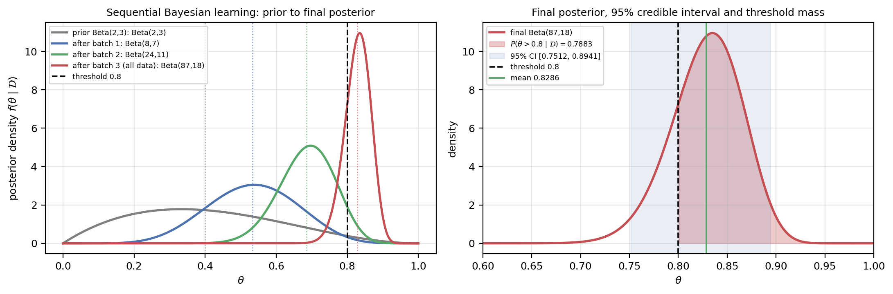
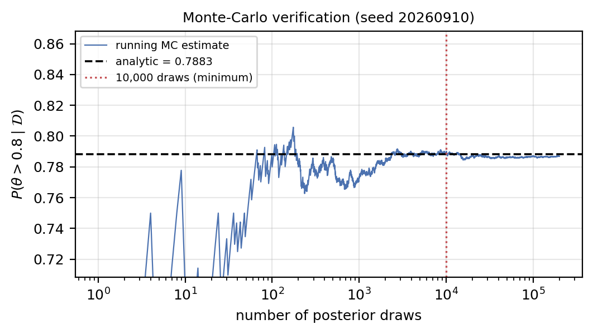
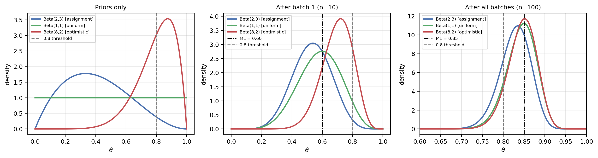

# Part B: Beta-Bernoulli Learning, Step by Step

This is a simple-language companion to `PartB_Beta_Bernoulli.ipynb`. The notebook studies a fruit-picking robot. It asks how likely the robot is to pick fruit successfully, and whether there is enough evidence to deploy it.

The numbers are hypothetical assignment data, not measurements from a real robot. Read the first six sections slowly, doing each calculation yourself before checking the next line.

## 1. What are we trying to learn?

Let `theta` (written as `θ` in the notebook) mean the robot's unknown chance of success on one attempt. One attempt is either a success (`X=1`) or a failure (`X=0`).

| Batch | New attempts | Successes | Failures |
|---|---:|---:|---:|
| 1 | 10 | 6 | 4 |
| 2 | 20 | 16 | 4 |
| 3 | 70 | 63 | 7 |
| **All batches** | **100** | **85** | **15** |

Each row is **new** attempts. Batch 2 is not a cumulative total. The robot and testing conditions are assumed unchanged, so one fixed `theta` applies to all batches.

The notebook has four parts:

| Part | Plain-English question |
|---|---|
| B1 | How do we describe one attempt and our uncertainty about `theta`? |
| B2 | How does each new batch change our belief? |
| B3 | How sure are we that `theta` is above 0.80? |
| B4 | Would a different starting belief change the decision? |

## 2. Bernoulli, Beta, prior, and posterior

A **Bernoulli** variable has two outcomes. If `theta=0.70`, then one attempt succeeds with chance 0.70 and fails with chance `1-0.70=0.30`.

```text
P(X=1 | theta) = theta
P(X=0 | theta) = 1-theta
```

The vertical line `|` means **given**. For example, `P(X=1 | theta=0.70)` means the chance of success given that the success rate is 0.70.

`theta` is not an attempt. It is a single unknown number between 0 and 1, shared by all attempts. A **Beta distribution** describes our uncertainty about that number:

```text
theta ~ Beta(alpha, beta)
```

Before the data, the notebook uses a **prior** of `Beta(2,3)`. Its mean is:

```text
prior mean = alpha / (alpha+beta)
           = 2 / (2+3)
           = 0.40
```

So the average starting belief is a 40% success rate. The numbers 2 and 3 are **prior shape values**, not real robot attempts. You can think of them as giving the prior roughly five pseudo-attempts of weight. Another convention treats `alpha-1` and `beta-1` as pseudo-successes and pseudo-failures when explaining the shape. Neither convention makes them observed data.

After seeing the attempts, our updated distribution is the **posterior**. A distribution is more informative than one guessed success rate: it says which rates are plausible and how uncertain we are.

### Why successes teach us about later attempts

If we knew `theta` exactly, one attempt would not change the next one's chance. This is called **conditional independence**. But when `theta` is unknown, a success makes us more optimistic about it, which also makes us more optimistic about the next attempt. The notebook demonstrates this by simulation.

## 3. Why the update is easy

If a batch contains `s` successes and `f` failures, its likelihood has this shape:

```text
theta^s × (1-theta)^f
```

For example, two successes and one failure give `theta^2 × (1-theta)`. At `theta=0.6`, this is `0.6 × 0.6 × 0.4 = 0.144` for that particular ordered sequence. The counts are enough to update the model; the order of attempts does not change the posterior shape.

The Beta prior has the shape `theta^(alpha-1) × (1-theta)^(beta-1)`. Multiplying prior and likelihood adds the powers:

```text
new alpha = old alpha + successes
new beta  = old beta  + failures

Beta(alpha,beta) + (s successes, f failures)
    -> Beta(alpha+s,beta+f)
```

This convenient pairing is called **conjugacy**. It means the answer remains a Beta distribution, so the notebook can update two numbers without numerical integration.

## 4. Do all three updates by hand

Start at `Beta(2,3)`.

**After Batch 1:** Add six successes and four failures.

```text
alpha = 2+6 = 8
beta  = 3+4 = 7
posterior = Beta(8,7)
posterior mean = 8/(8+7) = 8/15 = 0.5333
```

The observed success fraction is `6/10=0.6000`. The posterior mean is lower because the prior leaned toward smaller success rates.

**After Batch 2:** Start from `Beta(8,7)`, not the original prior.

```text
alpha = 8+16 = 24
beta  = 7+4  = 11
posterior = Beta(24,11)

cumulative successes = 6+16 = 22
cumulative attempts  = 10+20 = 30
observed fraction    = 22/30 = 0.7333
posterior mean       = 24/(24+11) = 24/35 = 0.6857
```

**After Batch 3:** Start from `Beta(24,11)`.

```text
alpha = 24+63 = 87
beta  = 11+7  = 18
final posterior = Beta(87,18)

cumulative successes = 6+16+63 = 85
cumulative failures  = 4+4+7   = 15
posterior mean       = 87/(87+18) = 87/105 = 0.828571...
```

You can also **pool** the data first, then update once:

```text
Beta(2+85, 3+15) = Beta(87,18)
```

The answer is identical. The six possible orders of the three batches also produce `Beta(87,18)`. The notebook checks both facts. A disagreement would suggest a counting or coding error.

## 5. Three different point estimates

The notebook calculates three single-number summaries. They answer different questions.

### ML: use the observed fraction only

**Maximum likelihood**, or **ML**, uses the data but no prior:

```text
ML = successes / attempts = 85/100 = 0.8500
```

### Posterior mean: average over our uncertainty

```text
posterior mean = alpha/(alpha+beta)
               = 87/105
               = 0.8286
```

### MAP: find the highest point on the posterior curve

**Maximum a posteriori**, or **MAP**, is the curve's mode. When `alpha>1` and `beta>1`:

```text
MAP = (alpha-1)/(alpha+beta-2)
    = (87-1)/(87+18-2)
    = 86/103
    = 0.8350
```

| Stage | Cumulative successes / attempts | ML | Posterior mean | MAP |
|---|---|---:|---:|---:|
| Before data | 0 / 0 | Undefined | 0.4000 | 0.3333 |
| After Batch 1 | 6 / 10 | 0.6000 | 0.5333 | 0.5385 |
| After Batch 2 | 22 / 30 | 0.7333 | 0.6857 | 0.6970 |
| After Batch 3 | 85 / 100 | 0.8500 | 0.8286 | 0.8350 |

The prior ML is undefined because `0/0` is undefined. The three final point estimates are all near 0.8, but none describes the remaining uncertainty by itself.

### Why MAP has `-1` and `-2` but the mean does not

The two formulas describe two different points on the same curve:

| Summary | Formula | Beta(8,7) after Batch 1 |
|---|---|---|
| Posterior mean (the average) | `alpha/(alpha+beta)` | `8/15 = 0.5333` |
| MAP (the highest point) | `(alpha-1)/(alpha+beta-2)` | `7/13 = 0.5385` |

The `-1` comes from how the Beta curve is built. Its shape is `theta^(alpha-1) × (1-theta)^(beta-1)`. That is the same shape as a likelihood with `alpha-1` successes and `beta-1` failures. The peak of "s successes and f failures" is at `s/(s+f)`, so:

```text
MAP = (alpha-1) / ((alpha-1) + (beta-1)) = (alpha-1) / (alpha+beta-2)
```

The `-2` is just the two `-1`s added together.

The mean is the average over the whole curve, not its highest point, and that average works out as `alpha/(alpha+beta)` with no `-1`. A lopsided curve has its average and its peak in different places. The prior `Beta(2,3)` has shape `theta × (1-theta)^2`:

| theta | height `theta × (1-theta)^2` |
|---:|---:|
| 0.20 | 0.128 |
| 0.333 | 0.148 (the peak, MAP = 1/3) |
| 0.40 | 0.144 (the mean, 2/5) |
| 0.50 | 0.125 |

The long tail on the right pulls the average to the right of the peak.

Analogy: household incomes. The most common income (the peak) is lower than the average income, because a few very high incomes pull the average up.

The code guards the formula with `if (alpha > 1 and beta > 1)`. If `alpha` or `beta` is 1 or less, the curve is highest at an edge (0 or 1), not in the middle, so the formula does not apply and the code returns `NaN`. That is why `Beta(1,1)` "prior only" shows `NaN` for MAP.

## 6. Uncertainty and the deployment decision

The final `Beta(87,18)` posterior has standard deviation about `0.0366`.

### Where the posterior standard deviation comes from

The `posterior sd` column comes from `d.std()` in `posterior_summary`, where `d = stats.beta(alpha, beta)`. SciPy uses the standard Beta formula:

```text
variance = alpha × beta / ( (alpha+beta)^2 × (alpha+beta+1) )
sd       = square root of variance
```

Worked example for Batch 1, `Beta(8,7)`:

```text
alpha+beta              = 15
alpha × beta            = 8 × 7 = 56
(alpha+beta)^2 × (16)   = 225 × 16 = 3600
variance                = 56 / 3600 = 0.015556
sd                      = 0.124722
```

| Stage | alpha, beta | variance | sd |
|---|---|---:|---:|
| Prior | 2, 3 | 0.040000 | 0.200000 |
| After Batch 1 | 8, 7 | 0.015556 | 0.124722 |
| After Batch 2 | 24, 11 | 0.005986 | 0.077372 |
| After Batch 3 | 87, 18 | 0.001340 | 0.036606 |

The mean is your best guess for `theta`. The sd is how unsure you still are about that guess. It shrinks as `alpha+beta` (all the counts so far) grows: before data `theta` could be roughly anywhere from 0 to 0.8, while after 100 attempts it is pinned to roughly 0.76 to 0.90.

### The interval

Its **95% equal-tailed credible interval** is approximately `[0.7512, 0.8941]`. Under the model and prior, 95% of posterior probability lies in that range. The notebook finds its endpoints with `stats.beta(...).ppf(0.025)` and `.ppf(0.975)`, leaving 2.5% of probability at each end.

The deployment rule is stricter than asking whether the mean is above 0.8:

```text
Deploy only if P(theta > 0.8 | data) >= 0.95.
```

For the final posterior, SciPy calculates:

```text
P(theta > 0.8 | data) = 0.78826666... = 78.83%
```

The chance of `theta` being at or below 0.8 is about `1-0.78827=0.21173`, or 21.17%. Therefore:

```text
0.78827 < 0.95  ->  rule not met  ->  do not deploy yet
```

This does not conflict with ML being 0.85. ML describes one best-fitting value. The rule concerns **all plausible values** in the posterior. A centre above the threshold is not enough when substantial posterior probability remains below it.

Analogy: a student scored 85 on a few practice tests, and the pass mark is 80. The average is above 80, but with only a few tests, a true ability of 78 is still believable. Before signing off, you want to be very sure, not just "the average looks fine".

How the posterior belief is spread across bands of `theta` (from `Beta(87,18)`):

| theta range | probability |
|---|---:|
| 0.70 to 0.75 | 0.022 |
| 0.75 to 0.80 | 0.188 |
| 0.80 to 0.85 | 0.495 |
| 0.85 to 0.90 | 0.278 |
| 0.90 to 0.95 | 0.015 |

About 21% of the belief is still below 0.8. That is the "substantial slice" the notebook mentions. The credible interval says the same thing: its lower end, 0.751, is below 0.8.

More data would narrow the curve. If future attempts keep succeeding about 85% of the time:

| Extra attempts | P(theta > 0.8) |
|---:|---:|
| +0 (now) | 0.788 |
| +100 | 0.930 |
| +140 | 0.954 (first to pass, checking in steps of 10) |
| +200 | 0.974 |

### Why the height of the curve is not the probability

The posterior is a **density curve**. The height at `theta=0.8`, written `f(0.8)`, is not `P(theta>0.8)`. A density height can even be greater than 1. The required probability is the **area** under the curve from 0.8 to 1. In code, `.sf(0.8)` gives this right-tail area. For a continuous variable, one exact point has probability zero; an interval can have positive probability.

### `f(0.8)` versus `F(0.8)`

Lowercase `f` and uppercase `F` are different things:

| | Name | What it is | For `Beta(87,18)` | Code |
|---|---|---|---:|---|
| `f(0.8)` | density (PDF) | The height of the curve at 0.8 | 7.256 | `d.pdf(0.8)` |
| `F(0.8)` | cumulative (CDF) | The area to the left of 0.8, which is `P(theta <= 0.8)` | 0.2117 | `d.cdf(0.8)` |
| `1 - F(0.8)` | survival | The area to the right of 0.8, which is `P(theta > 0.8)` | 0.7883 | `d.sf(0.8)` |

The whole area under the curve is 1, so `1 - F(0.8)` is everything to the right of 0.8.

Analogy: a car journey. `f` is the speedometer: how fast you are going at one instant (70 km/h is not a distance). `F` is the odometer: how far you have gone so far, which adds up all the speed along the way.

A height only becomes a probability when you multiply it by a width:

```text
P(0.795 < theta < 0.805) ≈ f(0.8) × 0.01 = 7.256 × 0.01 ≈ 0.0726
exact value from the Beta curve            = 0.0725
```

The posterior is squeezed into a narrow range, so the curve has to be tall (its peak is about 10.96) to keep the total area at 1. That is why a height can be above 1.

A tiny example you can check by hand: the straight line `f(theta) = 2 × theta` on 0 to 1 (this is `Beta(2,1)`).

- Height at 0.8: `f(0.8) = 1.6`. Above 1, so not a probability.
- Area to the left of 0.8 is a triangle: `0.5 × 0.8 × 1.6 = 0.64`, so `F(0.8) = 0.64`.
- So `P(theta > 0.8) = 1 - 0.64 = 0.36`.

The notebook's text says "f(0.8) = 4.6". The real height for the final posterior is 7.256. The point being made (a height is not a probability) is still correct.

## 7. Predict the next fruit pick

The posterior predictive question is: **What is the chance that the next attempt succeeds?** If we knew `theta`, that chance would equal `theta`. Since we do not, we average over the posterior:

```text
P(next success | data) = average theta under Beta(87,18)
                       = 87/105
                       = 0.828571... = 82.86%
```

For one Bernoulli attempt, this equals the posterior mean. It does not guarantee success. It is also a different question from `P(theta>0.8 | data)`: 82.86% predicts the next outcome; 78.83% expresses confidence about the unknown rate being above a threshold.

The report writes this as `∫ from 0 to 1 of theta × f(theta | D) dtheta`. The `∫` just means "average over every `theta` from 0 to 1, weighted by how much we believe it".

### Why the prediction does not use `Beta(88,18)`

`Beta(88,18)` is what you would believe **after** the next attempt has happened and succeeded. You cannot use it to predict that same attempt, because that would assume the answer.

| Question | Answer |
|---|---|
| Before attempt 101, how likely is success? | `87/105 = 0.8286`, from the current `Beta(87,18)` |
| After attempt 101 succeeds, what do I believe? | `Beta(88,18)`, mean `88/106 = 0.8302` |
| After attempt 101 fails, what do I believe? | `Beta(87,19)`, mean `87/106 = 0.8208` |

Analogy: you predict tomorrow's rain from what you know today. You cannot use tomorrow's updated record ("it rained") to predict whether it will rain.

Averaging the two possible futures gives back today's mean:

```text
0.8286 × 0.8302 + 0.1714 × 0.8208 = 0.8286
```

Using `Beta(88,18)`'s mean of 0.8302 as the prediction would always be biased towards success.

### Two attempts in a row: `E[theta^2] = 0.6879 > (E[theta])^2 = 0.6865`

The chance of one success is `theta`. The chance of two successes in a row is `theta × theta = theta^2`. There are two ways to turn that into a number:

| Method | Calculation | Result |
|---|---|---:|
| Plug-in (pretend `theta` is exactly 0.8286) | `0.8286^2` | 0.6865 |
| Bayesian (average `theta^2` over the posterior) | `E[theta^2]` | 0.6879 |

Tiny example. Suppose you are torn between a weaker robot (`theta = 0.7`) and a stronger one (`theta = 0.9`), equally likely. The average guess is 0.8.

```text
two in a row, weaker robot   : 0.7^2 = 0.49
two in a row, stronger robot : 0.9^2 = 0.81
average of the two           : (0.49 + 0.81) / 2 = 0.65
plug-in using the average    : 0.8^2 = 0.64
```

Squaring helps the strong robot more (0.64 to 0.81, +0.17) than it hurts the weak one (0.64 to 0.49, -0.15). So "average after squaring" comes out higher than "square the average". That is all **Jensen's inequality** says here: for a curved function like squaring, the average of the squares is at least the square of the average. They are equal only if there is no uncertainty.

The gap is exactly the posterior variance:

```text
E[theta^2] = (E[theta])^2 + variance
           = 0.686531 + 0.001340     (variance = 0.036606^2, from the sd table above)
           = 0.687871
```

The same answer, thinking one attempt at a time:

```text
P(1st succeeds)                 = 87/105 = 0.8286   (current belief Beta(87,18))
P(2nd succeeds | 1st succeeded) = 88/106 = 0.8302   (belief Beta(88,18))
P(both)                         = 0.8286 × 0.8302 = 0.6879
```

After the first success you become slightly more optimistic, so the second attempt gets a slightly higher chance. Plug-in assumes you learn nothing between the two attempts, so it is slightly too low.

"The coincidence vanishes for anything non-linear" means: for one attempt, the predictive happens to equal the posterior mean, but for anything curved like `theta^2` it does not.

## 8. Check the threshold by random draws

The notebook also draws 200,000 possible `theta` values from `Beta(87,18)` and counts how many exceed 0.8. This is **Monte Carlo**: use random examples to approximate an area under a curve.

Tiny practice example: suppose 10 drawn values are `0.78, 0.81, 0.84, 0.76, 0.91, 0.88, 0.79, 0.83, 0.74, 0.86`. Six exceed 0.8: `0.81, 0.84, 0.91, 0.88, 0.83, 0.86`. The tiny estimate is therefore `6/10=0.60`. It differs from the exact result because 10 draws are far too few.

The saved 200,000-draw estimate is `0.78688`, close to the exact `0.78827`. Random draws will not usually match the exact answer perfectly. The notebook uses seed `20260910` to make its random checks repeatable.

## 9. What if we had started with a different prior?

The notebook compares the assignment prior with a flat prior and a more optimistic prior:

| Prior | Prior mean | Shape after Batch 1 | Mean after Batch 1 | Final shape | Final mean |
|---|---:|---|---:|---|---:|
| Beta(2,3) | 0.40 | Beta(8,7) | 0.5333 | Beta(87,18) | 0.8286 |
| Beta(1,1) | 0.50 | Beta(7,5) | 0.5833 | Beta(86,16) | 0.8431 |
| Beta(8,2) | 0.80 | Beta(14,6) | 0.7000 | Beta(93,17) | 0.8455 |

After only 10 attempts, the starting choice makes a large difference. After 100 attempts, the three means are closer because the real data dominate the prior.

### A simple way to see it: three coaches

Picture a new basketball player with unknown shooting skill. Each coach starts with some **imaginary shots** in their head (the prior), then adds the real ones:

```text
estimate = (imaginary makes + real makes) / (imaginary shots + real shots)
```

| Coach | Prior | Imaginary shots |
|---|---|---|
| Careful | Beta(2,3) | 2 made out of 5 |
| No opinion | Beta(1,1) | 1 made out of 2 |
| Fan | Beta(8,2) | 8 made out of 10 |

After Batch 1 (6 out of 10 real):

| Coach | Calculation | Estimate | Share of the count that is real data |
|---|---|---:|---:|
| Careful | (2+6)/(5+10) = 8/15 | 0.533 | 10/15 = 0.67 |
| No opinion | (1+6)/(2+10) = 7/12 | 0.583 | 10/12 = 0.83 |
| Fan | (8+6)/(10+10) = 14/20 | 0.700 | 10/20 = 0.50 |

After all batches (85 out of 100 real):

| Coach | Calculation | Estimate | Share of the count that is real data |
|---|---|---:|---:|
| Careful | 87/105 | 0.829 | 100/105 = 0.95 |
| No opinion | 86/102 | 0.843 | 100/102 = 0.98 |
| Fan | 93/110 | 0.845 | 100/110 = 0.91 |

The spread between coaches shrinks from 0.167 to 0.017. Analogy: a cup of red dye (the prior) in a bucket. Add one cup of water and it stays very red. Add 100 cups and the starting colour barely shows.

That is why the notebook reports several priors: if the conclusion changes between reasonable priors, the data are too weak to support it.

### Why `P(theta > 0.8)` is more sensitive than the mean

The deployment-rule probabilities after all the data are approximately `0.7883`, `0.8811`, and `0.9009` for the three priors in that order. **None reaches 0.95.**

The means differ by only 0.017, but these probabilities differ by 0.11. The mean is the **centre** of the curve. `P(theta > 0.8)` depends on how much of the curve's **edge (tail)** pokes below 0.8. All three centres sit just above 0.8, so a small shift moves noticeably more area across the line. Like standing right next to a line on the floor: one small step changes a lot how much of you is over it.

With the flat `Beta(1,1)` prior, MAP equals ML. Hand calculation after all data:

```text
posterior = Beta(1+85, 1+15) = Beta(86,16)
MAP = (86-1)/(86+16-2) = 85/100 = 0.85 = ML
posterior mean = 86/102 = 0.8431
```

MAP and ML matching does **not** make the full posterior equal to an ML point estimate. The posterior still has a mean, interval, and probability above the deployment threshold.

Why they match: the flat prior's `+1`s cancel the `-1`s in the MAP formula, so only the real data are left (`85/100`). A flat prior favours no `theta`, so the highest point of the posterior is the highest point of the likelihood. The report calls this "the coincidence".

### Why the Bayesian answer is still not the same as ML

The match is only about the single highest point. Three things still differ.

**1. The prediction for the next attempt.** ML says `85/100 = 0.850`. The flat-prior Bayesian prediction is `(1+85)/(2+100) = 86/102 = 0.8431`. It behaves as if you had seen 1 extra success and 1 extra failure before starting. This is called **Laplace smoothing**, and it makes the answer slightly more cautious.

**2. ML gives one number; Bayes gives a whole range.** Analogy: asking two friends how long the drive to the airport takes.

- Friend ML: "40 minutes." Nothing more.
- Friend Bayes: "About 40, probably between 35 and 50, and a 10% chance it takes over an hour."

If your flight leaves in 45 minutes, only Friend Bayes can tell you how risky it is. The deployment rule ("are we at least 95% sure that `theta > 0.8`?") is a "how sure" question. ML has no way to answer it. The posterior does, by measuring the area above 0.8.

**3. The gap is biggest with very little data.** Suppose the robot succeeds 5 out of 5 times. With the flat prior the posterior is `Beta(1+5, 1+0) = Beta(6,1)`.

| Method | Answer | What it implies |
|---|---|---|
| ML (and MAP) | 5/5 = 1.0 | "It will never fail." |
| Bayesian predictive | (1+5)/(2+5) = 6/7 = 0.857 | "About a 1-in-7 chance the next one fails." |
| Bayesian 95% interval | [0.541, 0.996] | "The true rate could be anywhere from 54% to almost 100%." |
| `P(theta < 0.8)` | 0.262 | "About a 26% chance it is actually below standard." |

Analogy: a new restaurant with five 5-star reviews. ML says "perfect, it will never disappoint." Bayes says "probably very good, but five reviews is not much."

The report's last sentence, "optimising a point and carrying a distribution are different operations; only the second propagates uncertainty into the decision", means: ML picks one best-looking number and throws the rest away. Bayes keeps the whole range of possibilities, so your uncertainty is still there when you make the decision.

## 10. How the code matches the ideas

| Code | Plain-English job |
|---|---|
| `BATCHES` | Stores each batch's new attempts, successes, and failures. |
| `beta_update(alpha,beta,s,f)` | Returns `alpha+s, beta+f`. |
| `posterior_summary(...)` | Calculates ML, mean, MAP, spread, interval, and threshold chance. |
| `stats.beta(alpha,beta)` | Creates a Beta distribution object. |
| `.mean()` and `.std()` | Return its mean and standard deviation. |
| `.ppf(0.025)` / `.ppf(0.975)` | Find the 2.5% and 97.5% percentiles. |
| `.sf(0.8)` | Find the posterior area above 0.8. |
| `rng.beta(..., 200_000)` | Draw random possible `theta` values. |
| `integrate.trapezoid(...)` | Numerically checks areas under a finely sampled curve. |
| `to_csv(...)` | Saves results tables. |

The notebook checks that sequential updating equals pooled updating, that a numerical grid agrees with the Beta formula, and that changing batch order does not change the final posterior.

## 11. Read the saved figures



The curves move toward larger success rates and get narrower as data accumulate. In the right panel, the shaded area right of 0.8 is the probability needed for the decision.



This compares random-draw estimates with the exact threshold probability. More draws usually make the random estimate more stable.



Compare priors after one batch and after all batches. Early answers differ much more.

The main saved outputs are in `results/partB/`: `B2_sequential_updates.csv`, `B2_point_estimates.csv`, `B3_decision.json`, `B3_mc_convergence.csv`, `B4_prior_sensitivity.csv`, and the PNG figures above.

## 12. Notebook map

The cell positions below start at 1 and include Markdown cells. They are not Jupyter execution numbers.

| Cells | What to look for |
|---|---|
| 1-3 | Story, package setup, batches, seed, and constants. |
| 4-5 | Bernoulli/Beta model and independence demonstration. |
| 6-8 | Update formula, sequential calculations, and pooled/numerical checks. |
| 9-10 | Posterior plot and point-estimate table. |
| 11-15 | Predictive chance, interval, threshold decision, and Monte Carlo check. |
| 16-20 | Prior comparison and its interpretation. |
| 21 | Reproduction manifest and saved-file list. |

## 13. Try these by hand

1. Start with `Beta(2,3)` and observe 4 successes and 1 failure. **Answer:** `Beta(6,4)`.
2. Find the mean of `Beta(6,4)`. **Answer:** `6/(6+4)=0.60`.
3. Why is the final posterior not `Beta(85,15)`? **Answer:** Add the prior shape values: `Beta(2+85,3+15)=Beta(87,18)`.
4. Does `ML=0.85` mean there is an 85% chance that `theta>0.8`? **Answer:** No. That posterior tail probability is about 78.83%.
5. Would an average next-attempt success chance of 82.86% guarantee the next attempt succeeds? **Answer:** No. It is a probability, not a promise.

The key habit for this notebook is: **add successes to alpha, add failures to beta, and use the whole posterior when the decision asks about uncertainty.**
